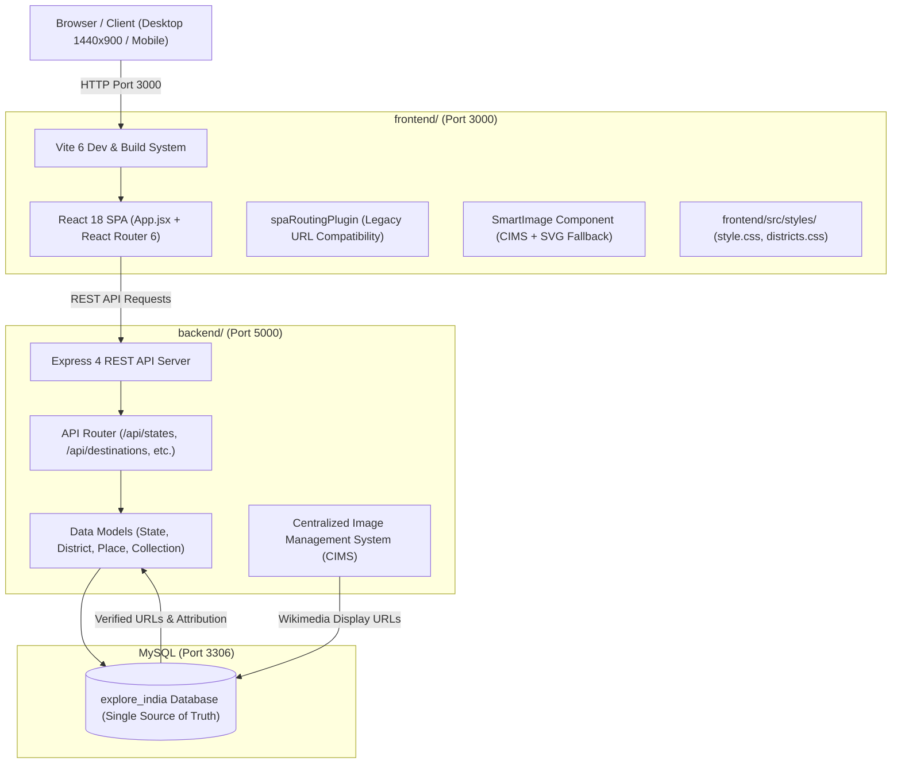

# Explore India — Comprehensive Project Cleanup & Architecture Audit

**Project:** Explore India — Tourist Guidance Website (Tourist_guide 2.0)  
**Task:** Project Audit, Safe Cleanup, Dependency Optimization, and Folder Reorganization  
**Status:** **AUDIT & BASELINE COMPLETE — PENDING USER APPROVAL**  
**Date:** November 28, 2026  

---

## 1. Executive Summary

This audit establishes a complete, evidence-based inventory of all files, directories, dependencies, and configuration mechanisms across the Explore India codebase. 

The application has successfully evolved across three historical stages:
1. **Stage 1 (Vanilla):** Original static HTML/CSS/JavaScript website with hardcoded datasets and direct DOM manipulation.
2. **Stage 2 (Root React + Vite):** Initial migration to a React Single Page Application (SPA) executed directly in the project root.
3. **Stage 3 (Full-Stack Workspace):** Modern architecture separating `frontend/` (React 18 + Vite SPA) and `backend/` (Node.js + Express + MySQL + CIMS) orchestrated via root npm scripts.

Because Stage 3 delegates all runtime, build, and testing tasks to `frontend/` and `backend/`, several legacy files, abandoned directories, and duplicate datasets from Stages 1 and 2 remain at the root level and within `frontend/src/data/`.

---

## 2. Active Application Architecture

### Key Architectural Invariants:
1. **Root `package.json`:** Contains **zero runtime dependencies** and delegates all operations:
   - `"dev"`: Runs `scripts/dev.mjs` (spawns backend on port 5000 and frontend on port 3000).
   - `"build"`: Executes `npm run build --prefix frontend`.
   - `"test"`: Executes `npm test --prefix backend`.
   - `"migrate" / "seed" / "verify-data"`: Runs backend database scripts.
2. **Frontend Independence:** `frontend/` is a self-contained Vite workspace. It has its own `package.json`, `node_modules`, `vite.config.js`, `index.html`, `public/`, and `src/`.
3. **Backend Independence:** `backend/` is a self-contained Express workspace with its own `package.json`, `node_modules`, `src/`, `tests/`, and `database/`.
4. **CIMS Database Single Source of Truth:** All 784 districts, 36 states/UTs, 52 collection items, and 172 attractions obtain their image URLs and metadata exclusively from MySQL.

---

## 3. Verified Application Baseline

Before proposing any cleanup, a comprehensive baseline was established and verified:

| Verification Suite | Target Command | Result | Metrics / Observations |
| :--- | :--- | :--- | :--- |
| **Frontend Production Build** | `npm run build` | **PASS (0 Errors)** | Vite v6.4.6 built in 897ms; 56 modules transformed; chunks rendered cleanly. |
| **Backend Regression Suite** | `npm test` | **PASS (0 Failures)** | 137 tests passed across 38 suites (100% pass rate). |
| **Database Connectivity** | `/api/health`, `/api/ready` | **PASS (200 OK)** | Local MySQL connection pool verified; all 784 districts and 36 states responsive. |
| **API Endpoints** | `verifyPhase3Apis.js` | **PASS (6/6 Endpoints)** | `/api/featured`, `/api/destinations`, `/api/top-places`, `/api/states`, `/api/places` return live CIMS URLs. |
| **Browser Visual Render** | Browser Subagent (1440x900) | **PASS (0 404s)** | Zero broken image icons; all 3 Home sliders, Explore, Top Places, States, and District pages load cleanly. |

---

## 4. Comprehensive Candidate Classification

### CATEGORY A: Confirmed Safe to Remove (Zero Dependencies)
Files and directories conclusively proven obsolete, abandoned from earlier project stages, or redundant build outputs.

| Target Path | Type | Size | Historical Origin | Justification & Proof |
| :--- | :---: | :---: | :--- | :--- |
| `dist/` (root) | Directory | 45.38 MB | Stage 2 Build Artifact | Outdated build from Nov 25 containing 154 deprecated local JPGs. The active build outputs exclusively to `frontend/dist/` (0.42 MB). |
| `.vite/` (root) | Directory | 0.01 MB | Stage 2 Vite Cache | Stale cache from Nov 25. Active Vite cache is created in `frontend/node_modules/.vite/`. |
| `node_modules/` (root) | Directory | 0.00 MB | Empty Leftover | Contains only an empty `.vite-temp` folder. Root has no dependencies. |
| `package-lock.json` (root) | File | 62.92 KB | Stage 2 Lockfile | Abandoned lockfile from when React was at root. Root `package.json` has 0 dependencies. |
| `index.vanilla.html` (root) | File | 32.27 KB | Stage 1 Backup | Backup of original vanilla homepage. 0 references in any script, component, or build tool. |
| `script.js` (root) | File | 37.25 KB | Stage 1 Logic | Original vanilla JS script. 0 imports or script tags reference it. |
| `districts.js` (root) | File | 827.46 KB | Stage 1 Dataset | Original vanilla dataset. Replaced by `backend/database/source-data/districts.js`. |
| `style.css` (root) | File | 45.66 KB | Stage 1 Stylesheet | Stale duplicate. Canonical stylesheet is in `frontend/src/styles/style.css`. |
| `districts.css` (root) | File | 23.27 KB | Stage 1 Stylesheet | Stale duplicate. Canonical stylesheet is in `frontend/src/styles/districts.css`. |
| `src/` (root) | Directory | 168.22 KB | Stage 2 React Snapshot | Stale source from Nov 24–25 missing `services/api.js`, `styles/`, and `AdminImages.jsx`. Active source is in `frontend/src/`. |
| `public/` (root) | Directory | 7.36 KB | Stage 2 Public Assets | Stale public assets. Active assets are in `frontend/public/`. |
| `index.html` (root) | File | 0.83 KB | Stage 2 HTML Entry | Stale entry point. Active entry point is `frontend/index.html`. |
| `vite.config.js` (root) | File | 1.76 KB | Stage 2 Config | Stale config. Active config is `frontend/vite.config.js`. |
| Root Static HTML Files (`coming-soon.html`, `district.html`, `explore.html`, `states.html`, `top-places.html`, `west-bengal.html`) | 6 Files | ~185 KB | Stage 1 Pages | Physical HTML files containing hardcoded vanilla DOM. All these routes are handled by React Router in `frontend/src/App.jsx` and static fallbacks are generated in `frontend/dist/`. |
| `frontend/districts.js` | File | 827.46 KB | Accidental Copy | Loose copy in `frontend/` root. 0 references in `frontend/src/`. |
| `frontend/src/data/` (all 9 files) | Directory | ~885 KB | Stage 2 Static Data | 0 imports in `frontend/src/`. All data is served dynamically by MySQL REST APIs. (Backend has its own authoritative copy in `backend/database/source-data/`). |

**Category A Total Reclaimable Space:** **~48.5 MB (230+ files)**

---

### CATEGORY B: Requires Specific Verification / User Decision
Files that are not used by the live application runtime, but represent historical backups or audit records.

| Target Path | Type | Size | Description | Recommendation |
| :--- | :---: | :---: | :--- | :--- |
| `quarantine_local_images/` | Directory | 93.46 MB | Holds 306 legacy local JPG images moved during Phase 3 verification. | Retain in workspace until user confirms external backup on D drive is satisfactory, or delete to reclaim 93.5 MB. |
| `scripts/verify_image_audit.mjs` | File | 5.13 KB | Standalone audit script from Nov 25 that verified local image paths. | Retain in `scripts/` or archive. |
| `backend/scripts/` (historical pilot scripts) | ~90 Files | ~1.5 MB | Pilot sync scripts for individual states (Phases 1–36). | Reorganize into `backend/scripts/archive/` to keep active scripts clean. |

---

### CATEGORY C: Must Keep (100% Essential)
Files required for runtime, development, build, testing, database maintenance, or documentation.

| Target Path | Purpose |
| :--- | :--- |
| `frontend/src/` | Complete active React application source code. |
| `frontend/public/` | Public assets, including protected functional fallback `destination-placeholder.svg`. |
| `frontend/package.json` & `package-lock.json` | Active frontend dependencies (React, GSAP, React Router, Vite). |
| `frontend/vite.config.js` | Active build configuration, proxy, and legacy SPA routing plugin. |
| `frontend/index.html` | Active HTML entry point for the React application. |
| `frontend/.env` & `.env.example` | Frontend environment variables. |
| `backend/src/` | Complete active Express server, models, controllers, CIMS services. |
| `backend/database/migrations/` | SQL schema and migration files (`001`, `002`, `migrate.js`). |
| `backend/database/seeds/` | Database seed logic (`seed.js`). |
| `backend/database/source-data/` | Authoritative source datasets required by `seed.js` and `verify-data.js`. |
| `backend/tests/` | 38 automated test suites verifying all 28 states, 8 UTs, and API routes. |
| `backend/scripts/verify-data.js` | Script executed by `npm run verify-data`. |
| `backend/package.json` & `package-lock.json` | Active backend dependencies (Express, MySQL2, Helmet, CORS, Supertest). |
| `backend/.env` & `.env.example` | Backend database credentials and port configurations. |
| `package.json` (root) | Root script orchestrator (`dev`, `build`, `test`, `migrate`, `seed`). |
| `scripts/dev.mjs` | Concurrent dev server launcher for backend and frontend. |
| `docs/` | All architecture, CIMS migration, and project documentation reports. |
| `.gitignore` & `README.md` | Repository configuration and documentation. |

---

### CATEGORY D: Proposed Professional Reorganization (Zero Risk)
Clean organizational adjustments to enhance maintainability and fix stylesheet resolution:

1. **Fix Stylesheet Import in `frontend/src/main.jsx`:**
   - Update `import '../style.css';` and `import '../districts.css';` to `import './styles/style.css';` and `import './styles/districts.css';`.
   - Remove duplicate `frontend/style.css` and `frontend/districts.css`.
   - This ensures the canonical styles in `frontend/src/styles/` (including `.facts-card` flex styling) are bundled directly.
2. **Move Root Markdown Reports to `docs/`:**
   - Relocate `IMAGE_AUDIT_REPORT.md` and `IMAGE_CREDITS.md` into `docs/` alongside the other migration reports.
3. **Archive Historical Migration Scripts:**
   - Move one-off pilot sync scripts in `backend/scripts/` into `backend/scripts/archive/` while retaining active verification scripts at the top level.

---

## 5. NPM Dependency Audit

### Frontend Dependencies (`frontend/package.json`):
- `gsap` (^3.12.5): **KEEP** — Active in `Home.jsx`, `Explore.jsx`, `TopPlaces.jsx`, `SliderSection.jsx`.
- `react` (^18.3.1): **KEEP** — Active across all 12 React components.
- `react-dom` (^18.3.1): **KEEP** — Active in `main.jsx` (`createRoot`).
- `react-router-dom` (^6.28.0): **KEEP** — Active for all client-side routing, navigation links, and parameters.
- `@vitejs/plugin-react` (^4.3.4): **KEEP** — Active in `vite.config.js`.
- `vite` (^6.0.1): **KEEP** — Active build tool and dev server.
- **Result:** **0 unused dependencies**. Every package is actively utilized.

### Backend Dependencies (`backend/package.json`):
- `cors` (^2.8.5): **KEEP** — Active in `app.js` for cross-origin resource sharing.
- `dotenv` (^16.4.7): **KEEP** — Active in `env.js` for environment variable loading.
- `express` (^4.21.2): **KEEP** — Active server framework.
- `express-rate-limit` (^7.5.0): **KEEP** — Active in `rateLimiter.js` for API abuse protection.
- `helmet` (^8.0.0): **KEEP** — Active in `app.js` for HTTP security headers.
- `mysql2` (^3.11.5): **KEEP** — Active in `db.js` for connection pooling.
- `nodemon` (^3.1.9): **KEEP** — Active in `package.json` dev script.
- `supertest` (^7.0.0): **KEEP** — Active across all 38 backend test suites.
- **Result:** **0 unused dependencies**. Every package is actively utilized.

---

## 6. Execution Plan & Rollback Strategy

The proposed cleanup is structured into **three safe, reversible batches**:

### Batch 1: Root Stale Build & Cache Cleanup (~45.4 MB)
- Remove root `dist/` (45.38 MB stale Nov 25 build).
- Remove root `.vite/` (stale cache).
- Remove root `node_modules/` (empty `.vite-temp`) and root `package-lock.json` (orphaned lockfile).
- **Verification:** Run `npm run build` and `npm test` to confirm zero impact.

### Batch 2: Root Legacy Vanilla & Source Cleanup (~2.2 MB)
- Remove root `src/` (stale Nov 24 snapshot).
- Remove root `public/` (stale Nov 24 public folder).
- Remove root `index.html` and `vite.config.js` (stale root configs).
- Remove root vanilla HTML files (`index.vanilla.html`, `coming-soon.html`, `district.html`, `explore.html`, `states.html`, `top-places.html`, `west-bengal.html`).
- Remove root vanilla scripts and styles (`script.js`, `districts.js`, `style.css`, `districts.css`).
- Relocate `IMAGE_AUDIT_REPORT.md` and `IMAGE_CREDITS.md` to `docs/`.
- **Verification:** Run `npm run build`, `npm test`, and probe dev server on `http://localhost:3000`.

### Batch 3: Frontend Internal Deduplication (~1.7 MB)
- Update `frontend/src/main.jsx` to import from `./styles/`.
- Remove redundant `frontend/style.css`, `frontend/districts.css`, and `frontend/districts.js`.
- Remove unused static data files in `frontend/src/data/` (9 files).
- **Verification:** Run `npm run build` and verify that the bundle transforms cleanly and district fast facts render properly.

### Rollback Mechanism:
Before each batch, all candidate files are backed up to a temporary rollback folder: `.cleanup_rollback/batch_N/`. In the event of any build failure, test failure, or visual anomaly, files are restored immediately with zero data loss.
