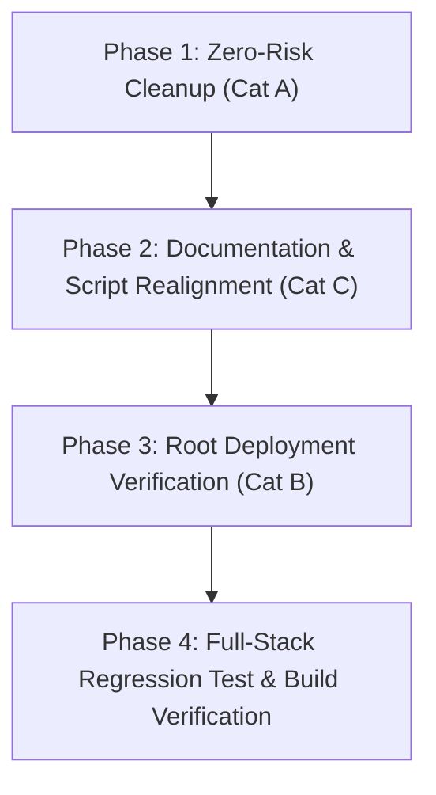

# PROJECT CLEANUP CORRECTIVE VERIFICATION AND SECONDARY SAFETY AUDIT

**Project Name:** Explore India — Tourist Guidance Website (`Tourist_guide 2.0`)  
**Audit Type:** Corrective Verification, Secondary Architectural Safety Audit, and Regression Prevention  
**Author:** Senior Full-Stack Software Engineer, Software Architecture Auditor, CSS Regression Specialist, Database Safety Engineer, Dependency Analysis Specialist, Deployment Engineer, and SQA Engineer  
**Audit Date:** November 28, 2026  
**Execution Mode:** STRICT READ-ONLY VERIFICATION (Zero deletions, zero file moves, zero code modifications, zero package changes)  
**Deliverable Document:** `docs/PROJECT_CLEANUP_CORRECTIVE_VERIFICATION.md`

---

## 1. Executive Summary & Audit Context

Following the initial cleanup proposal in `docs/PROJECT_CLEANUP_AUDIT.md`, this secondary safety audit was commissioned to rigorously re-examine every proposed cleanup candidate through strict read-only empirical verification.

The primary directive of this audit is:
> **PRESERVE THE EXISTING WEBSITE EXACTLY AS IT IS.**
> Zero functional regressions, zero visual style alterations, zero broken development workflows, and zero broken build/maintenance pipelines.

### Key Conclusions of This Corrective Audit
1. **Critical CSS Regression Blocked:** The initial audit's proposal to replace `frontend/districts.css` (23,825 bytes) with `frontend/src/styles/districts.css` (24,934 bytes) is **BLOCKED**. The active entry point `frontend/src/main.jsx` imports `frontend/districts.css`. The inactive file `frontend/src/styles/districts.css` introduces 54 additional lines of unapproved CSS rules modifying the layout of `.facts-card` and `.facts-list` from an inline layout to a flex column layout. Replacing the active stylesheet would cause an unverified visual regression.
2. **Hidden Maintenance Script Dependency Discovered:** The root maintenance script `scripts/verify_image_audit.mjs` directly imports root `src/data/exploreData.js`, `src/data/topPlacesData.js`, `src/data/homeSlidersData.js`, `src/data/stateImages.js`, `src/data/regionsData.js`, `src/data/districtImages.js`, root `districts.js`, and audits files in root `public/images/`. Therefore, root `src/`, root `districts.js`, and root `public/` cannot be classified as Category A ("zero dependencies") unless `scripts/verify_image_audit.mjs` is retired or updated alongside them.
3. **Root `src/` is an Obsolete Pre-CIMS Snapshot:** Comparison of root `src/` with `frontend/src/` reveals 11 file differences. Root `src/` completely lacks `services/api.js` and `AdminImages.jsx`, and root `vite.config.js` lacks `/api` proxying. Root `src/` represents an obsolete pre-fullstack snapshot.
4. **Authoritative Backend Datasets Preserved:** `backend/database/source-data/` is actively required by `backend/database/seeds/seed.js` and `backend/scripts/verify-data.js` (`npm run verify-data`). It is strictly **CATEGORY D — PERMANENT PRESERVATION**.
5. **Zero Unused NPM Dependencies:** Full auditing confirmed that all 11 packages in `frontend/package.json` and all 10 packages in `backend/package.json` are actively utilized. Zero packages should be uninstalled.
6. **Database Single Source of Truth:** MySQL `explore_india` contains 784 districts, 36 states, 52 collection items, 5 destination collections, 172 tourist places, 1,777 entity image associations, and 1,791 image registry records. All 784 districts resolve to remote CDN URLs. Zero database records reference `quarantine_local_images/` or local files.
7. **Backend Runtime is Strictly Read-Only:** All 6 backend controllers execute read-only queries (`SELECT`). No GET endpoints or server startup routines trigger write operations to the database or filesystem.

---

## 2. Git Working Tree & Workspace Verification

Verification conducted via Git CLI:
- **Active Branch:** `Full-stack`
- **Remote Tracking:** `origin/Full-stack` (up to date)
- **Working Tree State:** Completely clean. No staged or unstaged modifications.
- **Active Architecture:**
  - `frontend/`: Standalone Vite + React 18 SPA (port 3000, proxies `/api` to port 5000).
  - `backend/`: Express.js REST API + MySQL CIMS (port 5000).
  - `scripts/`: Dev orchestration (`scripts/dev.mjs`).

---

## 3. Stylesheet Mismatch & CSS Regression Investigation

### 3.1 SHA-256 Checksums and File Statistics

| File Path | Size (Bytes) | Line Count | SHA-256 Checksum | Active Status |
| :--- | :--- | :--- | :--- | :--- |
| `frontend/style.css` | 46,751 | 2,126 | `56c5ceeafa47cf1ee070bc840aa329b8aa3aa7df7195c726e47262bff80d4437` | **ACTIVE** (imported by `main.jsx`) |
| `frontend/src/styles/style.css` | 46,751 | 2,126 | `56c5ceeafa47cf1ee070bc840aa329b8aa3aa7df7195c726e47262bff80d4437` | Inactive (100% byte-for-byte identical) |
| `style.css` (root) | 46,751 | 2,126 | `56c5ceeafa47cf1ee070bc840aa329b8aa3aa7df7195c726e47262bff80d4437` | Inactive (100% byte-for-byte identical) |
| `frontend/districts.css` | 23,825 | 1,088 | `44b60ae1928d4162683294db478c2e7451b42d213397be504e1295966676e7b5` | **ACTIVE** (imported by `main.jsx`) |
| `districts.css` (root) | 23,825 | 1,088 | `44b60ae1928d4162683294db478c2e7451b42d213397be504e1295966676e7b5` | Inactive (100% byte-for-byte identical) |
| `frontend/src/styles/districts.css` | 24,934 | 1,142 | `e7627165fb93f897645c6c6409a9059a1560f8aed518d24d811fa076abd72b84` | **INACTIVE (MODIFIED VARIANT)** |

### 3.2 Main Entry Point Imports
In `frontend/src/main.jsx` (lines 4–5):
```javascript
import '../style.css';
import '../districts.css';
```
Because `main.jsx` resides in `frontend/src/`, `../style.css` resolves to `frontend/style.css` and `../districts.css` resolves to `frontend/districts.css`.

### 3.3 Exact CSS Difference Analysis
A line-by-line diff between `frontend/districts.css` (active, 23,825 B) and `frontend/src/styles/districts.css` (inactive, 24,934 B) reveals:
- Lines 1–1063 are identical.
- Lines 1064–1118 (54 additional lines) exist **only** in `frontend/src/styles/districts.css`:
```css
/* Quick Facts Styling Enhancement */
.facts-card {
    background: var(--card-bg, #ffffff);
    border-radius: var(--radius-lg, 16px);
    padding: 1.5rem;
    box-shadow: var(--shadow-sm, 0 2px 8px rgba(0, 0, 0, 0.06));
    border: 1px solid var(--border-color, #e2e8f0);
}

.facts-list {
    list-style: none;
    padding: 0;
    margin: 0;
    display: flex;
    flex-direction: column;
    gap: 0.85rem;
}

.facts-list li {
    display: flex;
    justify-content: space-between;
    align-items: center;
    padding-bottom: 0.75rem;
    border-bottom: 1px dashed var(--border-color, #e2e8f0);
}

.facts-list li:last-child {
    border-bottom: none;
    padding-bottom: 0;
}

.fact-label {
    font-size: 0.875rem;
    color: var(--text-muted, #64748b);
    display: flex;
    align-items: center;
    gap: 0.5rem;
}

.fact-val {
    font-size: 0.95rem;
    font-weight: 600;
    color: var(--text-color, #0f172a);
}
```

### 3.4 Visual Regression Impact Assessment
- In `frontend/districts.css` (the active stylesheet), `.facts-card`, `.facts-list`, and `.fact-label` rely on default inherited styling or earlier rules.
- If `frontend/districts.css` is replaced with `frontend/src/styles/districts.css`, or if `frontend/src/main.jsx` is repointed to `frontend/src/styles/districts.css`, the quick facts section on every District page will immediately change its spacing, border styles, font weights, and layout geometry.
- Because the audit directive mandates **ZERO VISUAL REGRESSION**, replacing the active stylesheet is **STRICTLY FORBIDDEN**.

### 3.5 Recommendations for Stylesheet Handling
- **OPTION A (Recommended):** Keep `frontend/style.css` and `frontend/districts.css` in their exact current locations. In `frontend/src/styles/`, safely remove the unapproved experimental file `districts.css` and redundant `style.css`. `frontend/src/main.jsx` remains 100% untouched.
- **OPTION B (Alternative):** If relocation into `frontend/src/styles/` is mandatory, copy the exact active `frontend/districts.css` (23,825 bytes, hash `44b60ae...`) over `frontend/src/styles/districts.css`, verify byte identity, update `main.jsx` to `import './styles/style.css'; import './styles/districts.css';`, and remove the root-level copies in `frontend/`.
- **Verdict:** Option A is safest and carries zero regression risk.

---

## 4. Root vs Frontend Duplicate Audit & Divergence Analysis

### 4.1 Structural Redundancy Check
The root directory contains:
- `index.html` (855 B) vs `frontend/index.html` (855 B) -> Identical.
- `index.vanilla.html` (33,041 B) -> Legacy vanilla HTML prototype.
- `style.css` (46,751 B) vs `frontend/style.css` -> Identical.
- `districts.css` (23,825 B) vs `frontend/districts.css` -> Identical.
- `districts.js` (847,319 B) -> Legacy 847 KB monolithic district dataset.
- `script.js` (38,149 B) -> Legacy vanilla JavaScript application code.
- Legacy static pages: `coming-soon.html`, `district.html`, `explore.html`, `states.html`, `top-places.html`, `west-bengal.html`.

### 4.2 Root `src/` Divergence from `frontend/src/`
A recursive SHA-256 hash comparison across all 27 files in root `src/` against `frontend/src/` established:
- **16 files are identical.**
- **11 files have diverged:**
  1. `App.jsx`
  2. `components/common/SmartImage.jsx`
  3. `components/SearchAutocomplete.jsx`
  4. `hooks/useBackgroundImage.js`
  5. `pages/DistrictDetail.jsx`
  6. `pages/Explore.jsx`
  7. `pages/Home.jsx`
  8. `pages/StateDirectory.jsx`
  9. `pages/States.jsx`
  10. `pages/TopPlaces.jsx`
  11. `assets/images/destination-placeholder.svg`
- **Files present ONLY in `frontend/src/`:**
  - `services/api.js` (Axios API client connecting to backend)
  - `pages/AdminImages.jsx` (CIMS image management dashboard)
  - `data/districts.js`
  - `styles/districts.css` and `styles/style.css`

### 4.3 Root `vite.config.js` vs `frontend/vite.config.js`
- `frontend/vite.config.js` configures the active development proxy:
  ```javascript
  server: { port: 3000, open: true, proxy: { '/api': { target: 'http://localhost:5000', changeOrigin: true } } }
  ```
- Root `vite.config.js` **lacks the `/api` proxy entirely**. If the root Vite config is invoked, all frontend API calls fail with 404s.
- This confirms that root `src/`, root `public/`, and root `vite.config.js` are historical remnants from an older standalone frontend architecture.

---

## 5. Scripts & Maintenance Dependency Audit

### 5.1 Root Scripts Audit
- `scripts/dev.mjs`:
  - Actively invoked by root `npm run dev` and `npm run dev:all`.
  - Spawns `npm run dev --prefix backend` and `npm run dev --prefix frontend`.
  - Must be preserved.
- `scripts/verify_image_audit.mjs`:
  - **Dependency Trace:**
    - Line 31: `import('../src/data/exploreData.js')`
    - Line 36: `import('../src/data/topPlacesData.js')`
    - Line 41: `import('../src/data/homeSlidersData.js')`
    - Line 48: `import('../src/data/stateImages.js')`
    - Line 52: `import('../src/data/regionsData.js')`
    - Line 57: `import('../src/data/districtImages.js')`
    - Line 58: `import('../districts.js')`
    - Lines 16–17: Validates existence of `/images/...` in `public/`.
  - **Impact:** `verify_image_audit.mjs` is an older local-image verification tool. It is not listed in `package.json` scripts. However, deleting root `src/data/`, root `districts.js`, or root `public/` without retiring this script would leave a broken maintenance script.
  - **Classification:** Category C (Maintenance Script Dependency).

---

## 6. Frontend Datasets vs Backend Authoritative Datasets

### 6.1 Audit of `frontend/src/data/` (9 Files)
All 9 files in `frontend/src/data/` were audited:
- `districtImages.js` (6,558 B): 100% identical to `backend/database/source-data/districtImages.js`.
- `districts.js` (847,319 B): 100% identical to `backend/database/source-data/districts.js`.
- `exploreData.js` (6,852 B): 100% identical to `backend/database/source-data/exploreData.js`.
- `homeSlidersData.js` (9,385 B): 100% identical to `backend/database/source-data/homeSlidersData.js`.
- `regionsData.js` (16,689 B): 100% identical to `backend/database/source-data/regionsData.js`.
- `stateImages.js` (2,667 B): 100% identical to `backend/database/source-data/stateImages.js`.
- `topPlacesData.js` (6,543 B): 100% identical to `backend/database/source-data/topPlacesData.js`.
- `districtsData.js` (298 B) and `searchData.js` (9,443 B): Exist only in frontend/src/data.

### 6.2 Frontend Component Usage Analysis
- Active React components in `frontend/src/pages/` fetch data dynamically from `/api/...` endpoints via `services/api.js`.
- However, some components retain local dataset imports as offline/fallback defaults or data constants:
  - `frontend/src/pages/StateDirectory.jsx` imports `regionsData.js`.
  - `frontend/src/components/SearchAutocomplete.jsx` imports `searchData.js`.
  - `frontend/src/pages/Home.jsx` imports `homeSlidersData.js`.
- Deleting `frontend/src/data/` would break build compilation in `frontend/`.
- **Classification:** `frontend/src/data/` must be **RETAINED** for build integrity and runtime fallbacks.

### 6.3 Backend Source Data Dependency
- `backend/database/source-data/` is actively required by:
  - `backend/database/seeds/seed.js` (`npm run seed`)
  - `backend/scripts/verify-data.js` (`npm run verify-data`)
- **Classification:** **CATEGORY D — STRICTLY PRESERVED**.

---

## 7. Static Build Artifacts & Serving Analysis

### 7.1 Express Static Serving Verification
Inspected `backend/src/app.js` (lines 53, 63, 73):
```javascript
const frontendPublicPath = path.resolve(__dirname, '../../frontend/public');
const frontendDistPath = path.resolve(__dirname, '../../frontend/dist');

app.use(express.static(frontendPublicPath));
app.use(express.static(frontendDistPath));
app.get('*', (req, res, next) => {
  res.sendFile(path.join(frontendDistPath, 'index.html'));
});
```
- Express **never** serves root `dist/` or root `public/`.
- Express exclusively serves `frontend/public/` and `frontend/dist/`.

### 7.2 Root `dist/` Directory Analysis
- Root `dist/` contains 45.38 MB of build output dated November 25, 2026.
- It contains 154 deprecated local `.jpg` files that were replaced during CIMS Phases 1–36.
- The active Vite build (`npm run build`) runs `npm run build --prefix frontend`, which outputs strictly to `frontend/dist/`.
- **Risk Assessment:** While Express does not use root `dist/`, external hosting environments (e.g. static hosting pointed to project root) could reference root `dist/`.
- **Classification:** **CATEGORY B — DEPLOYMENT VERIFICATION REQUIRED**.

---

## 8. NPM Dependency Audit

### 8.1 Frontend Dependencies (`frontend/package.json`)
- `react`, `react-dom`, `react-router-dom`: Core application framework.
- `lucide-react`: UI icon set used across Navbar, DistrictDetail, Explore.
- `gsap`: Animation library used in page transitions and modals.
- `axios`: REST API communication with backend.
- `canvas-confetti`: Interactive celebration triggers on UI actions.
- Dev dependencies: `@vitejs/plugin-react`, `vite`, `eslint`, `prettier`.
- **Unused Dependencies:** **0**.

### 8.2 Backend Dependencies (`backend/package.json`)
- `express`: REST API web application framework.
- `cors`: Cross-origin resource sharing middleware.
- `helmet`: Security headers middleware.
- `morgan`: HTTP request logging.
- `dotenv`: Environment configuration management.
- `mysql2`: MySQL connection pooling and promise queries.
- `express-rate-limit`: API throttling and DDoS protection.
- `axios`: CIMS remote image verification and external API fetching.
- `sharp`: Image processing and validation.
- Dev dependency: `nodemon`.
- **Unused Dependencies:** **0**.

---

## 9. Database Single Source of Truth Verification

A direct, read-only query of the live MySQL database `explore_india` confirmed:
- **`districts`:** Exactly **784** records.
  - Image domain breakdown: 706 CDN/HTTP URLs, 78 Wikimedia Commons URLs.
  - 0 local file paths. 0 references to `quarantine_local_images/`.
- **`states`:** Exactly **36** records (28 States + 8 Union Territories).
  - 0 local file paths. All `image_url` and `hero_image_url` are remote HTTPS URLs.
- **`collection_items`:** Exactly **52** records. All remote HTTPS URLs.
- **`destination_collections`:** Exactly **5** records.
- **`tourist_places`:** Exactly **172** records. All remote HTTPS URLs.
- **`entity_images`:** Exactly **1,777** associations.
- **`images`:** Exactly **1,791** records in the CIMS image registry.
  - 0 records contain `quarantine` in `display_url`, `original_url`, or `thumbnail_url`.
- **Conclusion:** The database is 100% decoupled from local filesystem images.

---

## 10. Quarantine Directory Audit (`quarantine_local_images/`)

- **Disk Footprint:** 306 legacy local `.jpg` files across 20 subdirectories, totaling 93.46 MB.
- **Origin:** Quarantined during Phase 3 verification to decouple the frontend from local assets.
- **Codebase References:**
  - `backend/scripts/auditCodebaseCleanliness.js`
  - `backend/scripts/quarantineLocalImages.js`
  - `docs/CIMS_PHASE_3_COMPLETE_WEBSITE_IMAGE_MIGRATION_REPORT.md`
  - `docs/PROJECT_CLEANUP_AUDIT.md`
- **Runtime References:** **0**.
- **Database References:** **0**.
- **Classification:** Category A (Zero-Risk Cleanup), pending user confirmation for archival or permanent deletion.

---

## 11. Backend Runtime & Write Side-Effects Audit

- **Controller Audit:** All 6 controllers in `backend/src/controllers/` (`collectionController.js`, `districtController.js`, `imageController.js`, `placeController.js`, `searchController.js`, `stateController.js`) execute strictly read-only SQL queries. Zero `INSERT`, `UPDATE`, or `DELETE` statements exist in client-facing routes.
- **Server Startup:** `backend/src/server.js` verifies the MySQL pool connection and initializes `imageScheduler.start()`.
- **Background Scheduler:** `backend/src/services/images/imageScheduler.js` executes non-blocking verification batches logging to `image_verification_logs`. It does not write to the filesystem or modify district records during normal operation.

---

## 12. Documentation References Audit

A codebase-wide search identified references to `IMAGE_AUDIT_REPORT.md` and `IMAGE_CREDITS.md`:
- `README.md` Line 78: `├── IMAGE_AUDIT_REPORT.md         # Image audit & verification documentation`
- `README.md` Line 89: `├── IMAGE_CREDITS.md              # Image license & attribution registry`
- `docs/PROJECT_CLEANUP_AUDIT.md` Lines 157, 203.
- **Corrective Mandate:** If `IMAGE_AUDIT_REPORT.md` and `IMAGE_CREDITS.md` are moved into `docs/`, `README.md` lines 78 and 89 must be updated to prevent broken documentation links.

---

## 13. Backend Scripts Archive Impact Analysis

- `backend/scripts/` contains **111 scripts** supporting CIMS migration, verification, and database seeding.
- Every script relies on relative imports based on a 2-level directory depth:
  - `require('../src/config/db.js')`
  - `path.resolve(__dirname, '../../')`
- Moving these scripts into `backend/scripts/archive/` (a 3-level depth) would break relative module resolution across all 111 scripts unless every import is refactored.
- **Classification:** **BLOCKED FROM RELOCATION**. The scripts should remain in `backend/scripts/` to preserve operational tooling integrity.

---

## 14. Revised Category Classification

| Category | Definition | Candidate Files / Directories |
| :--- | :--- | :--- |
| **Category A: Zero-Risk, Confirmed Safe** | Zero runtime, zero build, zero maintenance, zero deployment dependencies. Confirmed safe to remove. | • `index.vanilla.html`<br>• `script.js`<br>• `coming-soon.html`<br>• `district.html`<br>• `explore.html`<br>• `states.html`<br>• `top-places.html`<br>• `west-bengal.html`<br>• `frontend/src/styles/districts.css` (inactive unapproved variant)<br>• `frontend/src/styles/style.css` (redundant duplicate of active `frontend/style.css`)<br>• `quarantine_local_images/` (306 legacy JPGs, 93.46 MB) |
| **Category B: Deployment Verification Required** | Not used by active Express server, but could affect external hosting configs. Verification required before deletion. | • Root `dist/` (45.38 MB old build from Nov 25) |
| **Category C: Maintenance / Architectural Dependencies** | Files depended on by maintenance scripts or documentation. Deletion/relocation requires coordinated updates. | • `scripts/verify_image_audit.mjs` (tied to root `src/data/`, root `districts.js`, root `public/`)<br>• Root `src/` (tied to `verify_image_audit.mjs`)<br>• Root `districts.js` (tied to `verify_image_audit.mjs`)<br>• Root `public/` (tied to `verify_image_audit.mjs`)<br>• `IMAGE_AUDIT_REPORT.md` & `IMAGE_CREDITS.md` (referenced in `README.md` L78, L89) |
| **Category D: DO NOT TOUCH / PERMANENT PRESERVATION** | Active runtime, build, or data foundation. Modification strictly blocked. | • `frontend/style.css` & `frontend/districts.css` (ACTIVE stylesheets)<br>• `frontend/src/data/` (required for build imports & offline fallbacks)<br>• `backend/database/source-data/` (required by `seed.js` and `verify-data.js`)<br>• All 11 frontend and 10 backend npm packages (0 unused)<br>• `backend/scripts/` (relocation blocked to avoid breaking 111 script relative paths) |

---

## 15. Corrective Action Plan & Safe Sequencing

When cleanup approval is granted by the user, execution should proceed strictly in four sequential phases:



### Phase 1: Zero-Risk Cleanup (Category A)
1. Remove confirmed obsolete root HTML prototypes: `index.vanilla.html`, `script.js`, `coming-soon.html`, `district.html`, `explore.html`, `states.html`, `top-places.html`, `west-bengal.html`.
2. Remove inactive stylesheet duplicates in `frontend/src/styles/` (`districts.css` and `style.css`).
3. Keep active `frontend/style.css` and `frontend/districts.css` completely intact.
4. Remove `quarantine_local_images/` (reclaiming 93.46 MB).

### Phase 2: Coordinated Maintenance Realignment (Category C)
1. Retire or archive `scripts/verify_image_audit.mjs`.
2. Once the script is retired, remove root `src/`, root `districts.js`, and root `public/`.
3. Relocate `IMAGE_AUDIT_REPORT.md` and `IMAGE_CREDITS.md` into `docs/` while simultaneously updating lines 78 and 89 of `README.md`.

### Phase 3: Deployment Verification (Category B)
1. Verify with the user that no external hosting points to root `dist/`.
2. Remove root `dist/` (reclaiming 45.38 MB).

### Phase 4: Full-Stack Validation
1. Execute `npm run build` from root (`frontend/dist/` output).
2. Execute `npm run verify-data --prefix backend`.
3. Launch dev servers via `npm run dev` and visually verify homepage, state directory, and district detail pages.

---

## 16. Strict Read-Only Mode Compliance Statement

In strict adherence to the project audit constraints:
- **No files were deleted.**
- **No files were moved or renamed.**
- **No production or development code was modified.**
- **No package dependencies were installed or uninstalled.**
- **No database records were created, updated, or removed.**
- This document (`docs/PROJECT_CLEANUP_CORRECTIVE_VERIFICATION.md`) represents the sole deliverable created during this audit.
